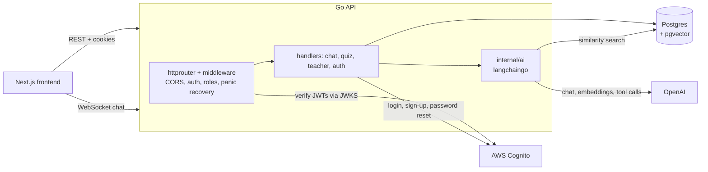

# Chatty Chapters

An AI reading tutor for college music courses. Students pick the chapter they're
reading and chat with a tutor that answers from the textbook itself. Once they've
asked good enough questions, they take a short quiz generated from their own
conversation. Teachers get a dashboard of every student's chat and quiz results,
chapter by chapter.

I built this to supplement the online music courses I taught in Fall 2024. The app is
no longer deployed, but everything here runs locally.

<!-- TODO: add a screenshot or GIF of the chat and teacher dashboard -->

## How it works

1. **Chat with the chapter.** The student chats with the tutor over a WebSocket.
   Each message is embedded and run as a similarity search in pgvector, filtered to
   the current book and chapter, and the matching passages are passed to the LLM as
   context. The reply streams back token by token.
2. **Earn the chat credit.** After each exchange, a background goroutine collects the
   student's questions and asks the LLM to grade how well they engage with the
   reading. The grading uses tool calling, so the score comes back as structured JSON.
   A passing score unlocks the quiz.
3. **Take a quiz built from the conversation.** Quiz questions are generated from the
   student's chat history plus the relevant chapter passages, so each student gets
   questions about what they actually discussed.
4. **Get graded with feedback.** Answers are assessed against the chapter text, with a
   score and written feedback for each question.
5. **Teacher review.** Teachers see results across a course, drill into a chapter, and
   read an individual student's conversations and quiz answers.

## Architecture



| | Stack |
| --- | --- |
| [`frontend/`](frontend) | Next.js 14 (App Router), React 18, TypeScript, Tailwind CSS, shadcn/ui |
| [`backend/`](backend) | Go, Postgres 16 + pgvector, OpenAI via langchaingo, AWS Cognito, WebSockets |

Each folder has its own README with the details.

## Running locally

You'll need Go 1.22+, Node 20+ with pnpm, Docker, and an OpenAI API key. Logging in
also requires a Cognito user pool (see [backend/README.md](backend/README.md#logging-in)).

```sh
# API on :8080
cd backend
cp .env.example .env   # add your OPENAI key and Cognito ids
make up                # Postgres + pgvector in Docker, then migrations
make seed              # demo users, books, courses, and embeddings
make run/front         # API with CORS open to localhost:3000

# Frontend on :3000, in another terminal
cd frontend
cp .env.example .env.local
pnpm install
pnpm dev
```

## Credits

Built by [Keegan Anglim](https://github.com/guitarkeegan). Daniel Johnson contributed
the frontend's breadcrumb navigation, navbar, and chapter grid layout.

The sample books are public domain texts from [Project Gutenberg](https://www.gutenberg.org).
