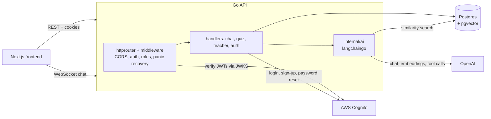

# Music Class Tutor

An AI reading tutor for college music courses. Students pick the chapter they're
reading and chat with a tutor that answers from the textbook itself. Once they've
asked good enough questions, they take a short quiz generated from their own
conversation. Teachers get a dashboard of every student's chat and quiz results,
chapter by chapter.

I built this Go API to supplement the online music courses I taught in Fall 2024.
The [Next.js frontend](#frontend) lives in a separate repo. The app is no longer
deployed, but everything here runs locally.

## How it works

1. **Chat with the chapter.** The student chats with the tutor over a WebSocket.
   Each message is embedded and run as a similarity search in pgvector, filtered to
   the current book and chapter, and the matching passages are passed to the LLM as
   context. The reply streams back token by token.
2. **Earn the chat credit.** After each exchange, a background goroutine collects the
   student's questions and asks the LLM to grade how well they engage with the
   reading. The grading uses tool calling, so the score comes back as structured JSON.
   A passing score unlocks the quiz.
3. **Take a quiz built from the conversation.** Quiz questions are generated from the
   student's chat history plus the relevant chapter passages, so each student gets
   questions about what they actually discussed.
4. **Get graded with feedback.** Answers are assessed against the chapter text, with a
   score and written feedback for each question.
5. **Teacher review.** Teachers see results across a course, drill into a chapter, and
   read an individual student's conversations and quiz answers.

## Architecture



| Area | Details |
| --- | --- |
| Language | Go, `net/http` with `julienschmidt/httprouter` |
| Data | Postgres 16 with `pgvector` and `citext`, accessed with `pgx` and versioned SQL migrations (`golang-migrate`) |
| AI | OpenAI `gpt-4o` and `gpt-4o-mini` through `langchaingo`; `text-embedding-3-large` embeddings; tool calling for structured grading |
| Auth | AWS Cognito; the API verifies ID tokens against Cognito's JWKS (cached), stores tokens in cookies, and refreshes them transparently in middleware; `student` and `teacher` roles |
| Realtime | `gorilla/websocket` for streaming chat |
| Deployment (when it was live) | A single EC2 instance with systemd and Caddy for TLS; see `remote/` |

## Project layout

```
cmd/api/          HTTP server: routes, middleware, handlers, auth
internal/ai/      LLM chat, quiz generation, and grading
internal/data/    Postgres models
internal/seed/    demo data and the book embedding pipeline
internal/canvas/  Canvas LMS API client for syncing grades (work in progress, not yet wired in)
migrations/       SQL migrations
books/            chapter text, one file per chapter
dummy_client/     a minimal HTML client for testing login without the frontend
remote/           server setup script, systemd unit, and Caddyfile
```

## Running locally

You'll need Go 1.22+, Docker, and an OpenAI API key. Logging in also requires a
Cognito user pool.

```sh
cp .env.example .env   # then add your OPENAI key (and Cognito ids, to log in)
make up                # start Postgres + pgvector in Docker and run the migrations
make seed              # demo users, books, courses, and the book embeddings
make run/front         # start the API on :8080 with CORS open to the local frontend
```

Run `make help` to see every target.

### Logging in

Auth goes through Cognito, so you'll need your own user pool and app client (set
`USER_POOL_ID` and `USER_POOL_CLIENT_ID`). The seeded demo users have random
`cognito_sub` values; to log in as one, set its `cognito_sub` to the `sub` of a user
in your pool. Make the teacher a teacher with
`UPDATE users SET role = 'teacher' WHERE email = 'teacher@example.com';`.

## Tests

```sh
make test               # unit tests, no services needed (this is what CI runs)
make test/integration   # also runs tests that need Postgres, OpenAI, Cognito, and Canvas
```

## Sample books

The real courses used copyrighted textbooks, which aren't included. The demo uses two
public domain books from [Project Gutenberg](https://www.gutenberg.org):

- *Alice's Adventures in Wonderland* by Lewis Carroll
- *Life of Chopin* by Franz Liszt, translated by M. Walker Cook

Each chapter is a text file in `books/<title>/`, named
`title-author-edition-chapter.txt`. The embedding seeder parses that name into the
metadata used to filter search results by book and chapter. To add a book, add its
files there and its chapters in `internal/seed/seed_chapters.go`.

## Frontend

The Next.js frontend lives in a separate repo.
